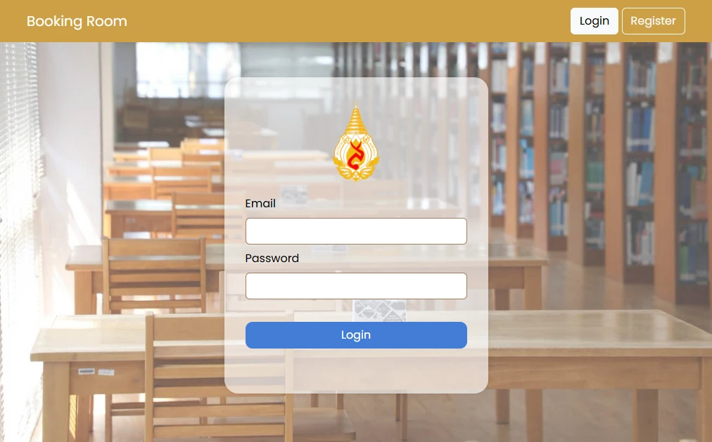
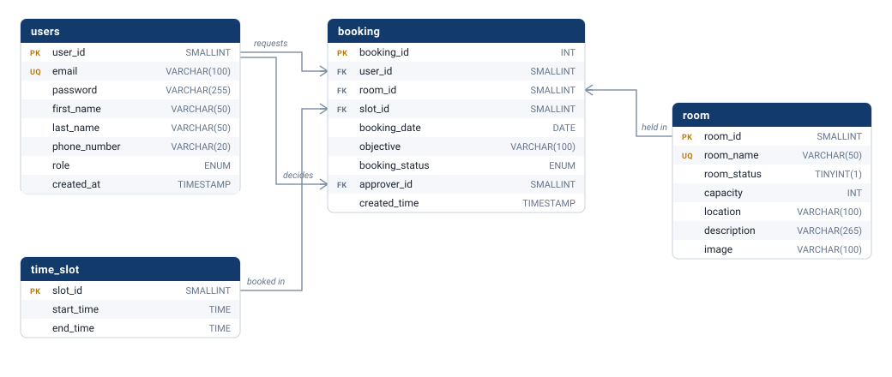

# Library Room Reservation System

A web application for booking university library rooms. Students request a room
for a fixed time slot, lecturers approve or reject those requests, and library
staff manage the rooms themselves. Each role gets its own set of pages, enforced
server-side.

Built with Node.js, Express, MySQL and server-rendered HTML with vanilla
JavaScript on the client.

<p align="center">
  
</p>

<p align="center">
  <sub>The web app on the left. The same booking model also exists as a Flutter
  client, in
  <a href="https://github.com/Zenzee7711/library-room-booking-mobile">library-room-booking-mobile</a>.</sub>
</p>

## Contents

- [Features](#features)
- [Screenshots](#screenshots)
- [How it works](#how-it-works)
- [Tech stack](#tech-stack)
- [Project structure](#project-structure)
- [Database](#database)
- [Getting started](#getting-started)
- [API reference](#api-reference)
- [Access control](#access-control)
- [Known limitations](#known-limitations)

## Features

**Student**

- Register an account and sign in
- Browse every room with a live grid of today's slots (free, pending, reserved, disabled)
- Request a room for a date and time slot, with a stated objective
- Track the status of the current day's request
- Review past approved and rejected bookings

**Lecturer**

- Dashboard summarising how today's slots are allocated
- Queue of the day's pending requests, approved or rejected in one click
- History of every decision the signed-in lecturer has made

**Library staff**

- Dashboard summarising slot usage
- Add rooms with a photo, capacity, location and description
- Edit room details and replace room photos
- Take rooms offline and back online, blocked while a room still has active bookings
- Audit history of every decided booking across the library

## Screenshots

<p align="center">
  
</p>

One sign-in form serves all three roles. Where it sends you afterwards comes
from the `role` stored against the account, not from anything the browser picks.

The screens were drawn in Figma before they were built — the design file is
public: **[Room reservation, web](https://www.figma.com/design/IYR2kLPBnQVvpdUNdZ7UQo/Group2-Section3)**.

## How it works

A single Express process serves everything, the HTML included. There is no
front-end build step and no template engine: the pages are static files that
fetch their own data from the same API.

```
browser
  |
  v
Express  (src/app.js)
  |-- express-session        restores the signed-in user from the cookie
  |-- pages.routes.js        role check, then sends a file from public/view
  |-- auth / rooms /         role check, then JSON in and JSON out
  |     bookings routes
  v
mysql2 connection pool  (src/config/db.js)
  |
  v
MySQL   library_room_reservation
```

So loading a page takes two requests. The browser asks for `/student/rooms`;
`pages.routes.js` confirms the session belongs to a student and returns the
HTML. That page's script then calls `/api/rooms/availability` and renders the
grid. The HTML carries no booking data of its own, which is why one file serves
every user and every day.

Signing in creates a session rather than a token. `POST /login` compares the
submitted password against the bcrypt hash in `users.password` and, on a match,
stores the user id and role in the session. Every later request is identified by
that cookie, so the user a booking is filed against is never a value the browser
sent.

## Tech stack

| Layer     | Technology                                      |
| --------- | ----------------------------------------------- |
| Runtime   | Node.js 18+                                     |
| Server    | Express 4                                       |
| Database  | MySQL 8 / MariaDB 10.4, accessed with `mysql2`  |
| Auth      | `express-session` with bcrypt password hashing  |
| Uploads   | `multer`, restricted by MIME type and file size |
| Frontend  | HTML, Bootstrap 5, vanilla JavaScript, SweetAlert2 |

## Project structure

```
src/
├── server.js               Process entry point and graceful shutdown
├── app.js                  Express app, middleware chain, error handling
├── config/
│   ├── env.js              Reads and validates environment variables
│   └── db.js               MySQL connection pool and query helper
├── middleware/
│   ├── auth.js             requireAuth, requireRole, requirePageRole
│   └── upload.js           Multer storage, size limit and MIME filter
└── routes/
    ├── pages.routes.js     HTML pages, each behind a role check
    ├── auth.routes.js      Register, login, logout
    ├── rooms.routes.js     Room CRUD, availability grid, dashboard counts
    └── bookings.routes.js  Booking requests, approvals, history

public/
├── view/                   Page templates, served only through pages.routes.js
├── images/                 Images committed with the repository
└── uploads/                Room photos uploaded at runtime (git-ignored)

database/
├── schema.sql              Tables, keys and foreign keys
└── seed.sql                Demo rooms and time slots
```

## Database

MySQL, four tables. Only `booking` carries foreign keys: it is the junction that
ties a person, a room and a time of day to a date.

<p align="center">
  
</p>

### What each table holds

| Table       | One row is                      | Worth knowing                                                                                           |
| ----------- | ------------------------------- | ------------------------------------------------------------------------------------------------------- |
| `users`     | an account                      | `email` is unique; `role` is `student`, `lecturer` or `staff`, and decides what the account can reach     |
| `room`      | a bookable room                 | `room_status` is 1 for bookable, 0 for taken offline by staff; `image` holds a filename, not a path       |
| `time_slot` | one of the fixed daily periods  | seeded with four: 08–10, 10–12, 13–15, 15–17. A slot belongs to the day, not to any particular room      |
| `booking`   | one request for a room and slot | carries the status, the stated objective, and which lecturer decided it                                   |

### How they link

`room` and `time_slot` never reference one another. Every room is bookable in
every slot, so the grid the interface draws is simply their cross product —
`room × time_slot` — and a row in `booking` is what claims one cell of that grid
for one date.

- `booking.user_id → users.user_id` — who asked.
- `booking.room_id → room.room_id` — which room.
- `booking.slot_id → time_slot.slot_id` — which period of the day.
- `booking.approver_id → users.user_id` — the lecturer who decided it, `NULL`
  while the request is still `Waiting`. This is a second foreign key into
  `users`, which is why the diagram draws two lines between the same pair of
  tables.

A reservation is therefore identified by `(room_id, slot_id, booking_date)`, and
`booking_status` says whether the row actually holds that cell: it starts
`Waiting` and a lecturer moves it to `Approved` or `Rejected`. The composite
index `idx_booking_room_slot_date` exists for exactly that lookup, because
almost every page performs it.

Nothing is ever deleted. A room goes offline through `room_status` instead of a
`DELETE`, so an old booking still resolves to a real room long after that room
stops being bookable.

### Working out what is free

`GET /api/rooms/availability` builds the whole grid in one query — a `CROSS JOIN`
between `room` and `time_slot`, with a correlated subquery pulling the latest
booking for each cell on today's date:

```sql
SELECT r.room_id, r.room_name, r.room_status,
       ts.slot_id, ts.start_time, ts.end_time,
       (SELECT b.booking_status
          FROM booking b
         WHERE b.room_id = r.room_id
           AND b.slot_id = ts.slot_id
           AND b.booking_date = CURDATE()
         ORDER BY b.created_time DESC
         LIMIT 1) AS booking_status
  FROM room r
  CROSS JOIN time_slot ts
 ORDER BY r.room_name, ts.slot_id;
```

Each cell is then coloured from those two values. A room with `room_status = 0`
reads *disabled* whatever its bookings say; otherwise `Waiting` reads *pending*,
`Approved` reads *reserved*, and anything else reads *free*.

Because the grid a browser is holding may be seconds out of date, two rules are
checked again when a request is actually submitted:

1. the `(room, slot, date)` cell must not already hold a `Waiting` or `Approved`
   booking, and
2. the student must not already have an active booking that day — one room per
   student per day.

Both are checks rather than database constraints, which is the race noted under
[Known limitations](#known-limitations).

## Getting started

### Prerequisites

- Node.js 18 or newer
- MySQL 8 or MariaDB 10.4 (XAMPP works)

### 1. Install dependencies

```bash
npm install
```

### 2. Create the database

```bash
mysql -u root -p < database/schema.sql
mysql -u root -p < database/seed.sql
```

### 3. Configure the environment

```bash
cp .env.example .env
```

Fill in your MySQL credentials and set `SESSION_SECRET` to a long random string:

```bash
node -e "console.log(require('crypto').randomBytes(32).toString('hex'))"
```

### 4. Run the server

```bash
npm run dev     # nodemon, reloads on change
npm start       # plain node
```

The app is served at `http://localhost:3000`.

### 5. Create accounts

The seed data contains rooms and time slots but no users, because passwords are
bcrypt hashes generated by the application.

Register a student at `http://localhost:3000/register`. To try the lecturer and
staff views, register two more accounts and promote them:

```sql
USE library_room_reservation;
UPDATE users SET role = 'lecturer' WHERE email = 'lecturer@example.com';
UPDATE users SET role = 'staff'    WHERE email = 'staff@example.com';
```

Self-registration deliberately only creates students, so an account cannot grant
itself approval rights.

## API reference

All endpoints return JSON. The role column shows who may call each one; anything
other than `public` requires a signed-in session with that role.

| Method | Endpoint                             | Role             | Purpose                                  |
| ------ | ------------------------------------ | ---------------- | ---------------------------------------- |
| POST   | `/login`                             | public           | Sign in, returns the role's landing page |
| POST   | `/register/create`                   | public           | Register a student account               |
| POST   | `/logout`                            | any              | Destroy the session                      |
| GET    | `/api/currentdate`                   | public           | Today's date in Asia/Bangkok             |
| GET    | `/api/rooms/availability`            | any              | Rooms with today's per-slot status       |
| GET    | `/api/dashboard/slots`               | staff, lecturer  | Free/pending/reserved/disabled counts    |
| GET    | `/api/student/room/:room_id`         | student          | Room detail for the booking form         |
| POST   | `/api/student/book`                  | student          | Submit a booking request                 |
| GET    | `/api/student/bookings`              | student          | The student's requests for today         |
| GET    | `/api/student/history`               | student          | The student's decided bookings           |
| GET    | `/api/lecturer/approvals`            | lecturer         | Today's pending requests                 |
| POST   | `/api/lecturer/approval-action`      | lecturer         | Approve or reject a request              |
| GET    | `/api/lecturer/history`              | lecturer         | Decisions made by this lecturer          |
| GET    | `/api/staff/rooms`                   | staff            | All rooms with status                    |
| GET    | `/api/staff/rooms/:room_id`          | staff            | One room                                 |
| POST   | `/api/staff/addroom`                 | staff            | Create a room with a photo               |
| PUT    | `/api/staff/rooms/:room_id`          | staff            | Update name, capacity, description       |
| PUT    | `/api/staff/rooms/:room_id/image`    | staff            | Replace the room photo                   |
| POST   | `/api/staff/rooms/status`            | staff            | Enable or disable a room                 |
| GET    | `/api/staff/history`                 | staff            | Every decided booking                    |

## Access control

Three rules the code holds to:

1. **Identity comes from the session, never the request.** A booking is filed
   against `req.session.user_id` and an approval is recorded against the
   lecturer's own session id. A client cannot book or approve as somebody else
   by editing the request body.
2. **Pages are guarded like endpoints.** The HTML in `public/view` is not mounted
   as static files. Every page is served through a route carrying the same role
   check as its API, so a staff page cannot be opened by typing its filename.
3. **Self-registration cannot escalate.** `/register/create` rejects any role
   other than `student`.

Passwords are stored as bcrypt hashes. Session cookies are `httpOnly` and
`sameSite=lax`, and can be marked `secure` through `SESSION_COOKIE_SECURE` once
the app is served over HTTPS.

## Known limitations

- **Booking conflicts are checked, not locked.** Availability is verified
  immediately before the insert, so two requests arriving in the same instant
  could both pass. A partial unique index would close this, which MySQL does not
  support; the next step would be a transaction with `SELECT ... FOR UPDATE`.
- **Dates are fixed to Asia/Bangkok.** The timezone is a constant rather than a
  per-user setting.
- **No automated tests.** Behaviour was verified by hand across the three roles.
- **Sessions are stored in memory**, so restarting the server signs everyone out.
  A production deployment would use a session store backed by Redis or MySQL.

## Project context

Originally built for a university web development course, as a team project.
This repository is my own cleaned-up version of that work, published with the
team's coursework artefacts left out.

What changed between the coursework version and this one:

- Database credentials and the session secret moved out of source into `.env`
- Role checks added to every API endpoint, and to the pages themselves, which
  were previously served as static files anyone could request directly
- Booking and approval identity taken from the session instead of a value the
  browser sends, which could be edited to act as another user
- Database layer moved from a single `mysql` connection to a `mysql2` pool
- The 718-line `app.js` split into config, middleware and route modules
- A schema that matches the application: the bundled SQL dump was missing the
  `location` and `phone_number` columns the code queries

## License

MIT — see [LICENSE](LICENSE).
